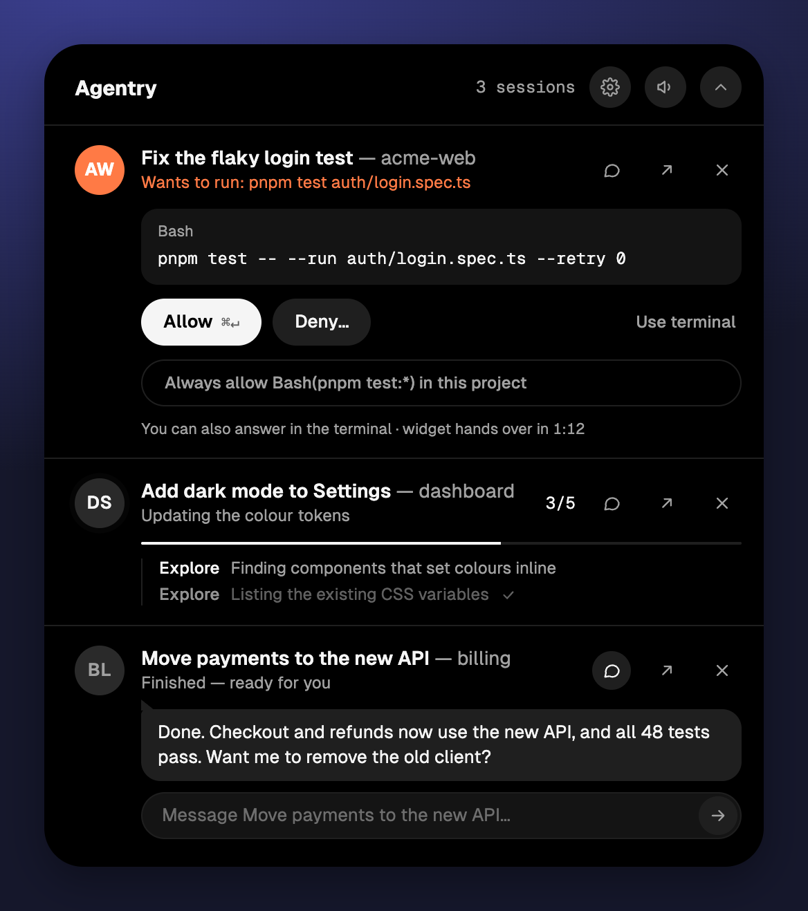
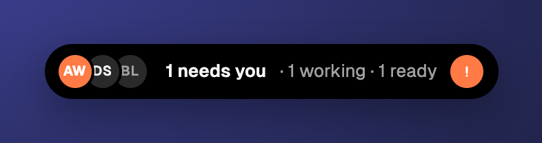
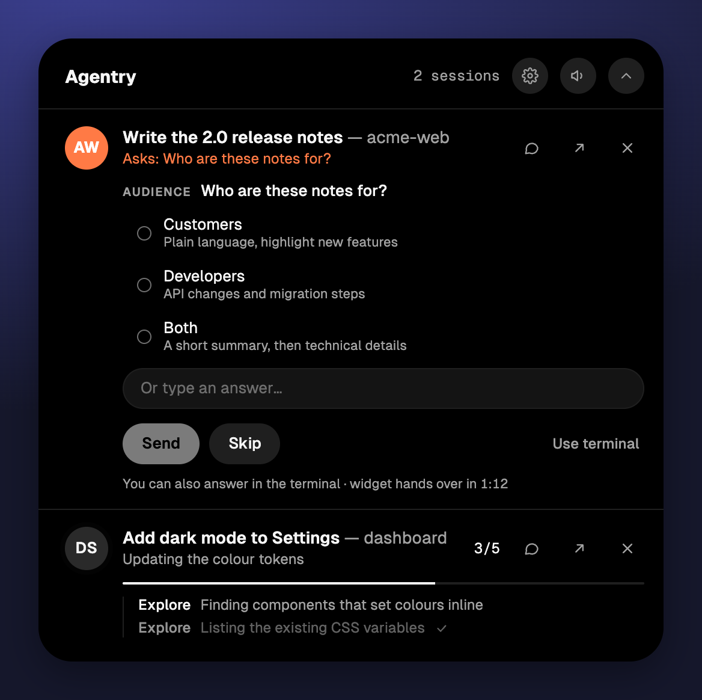
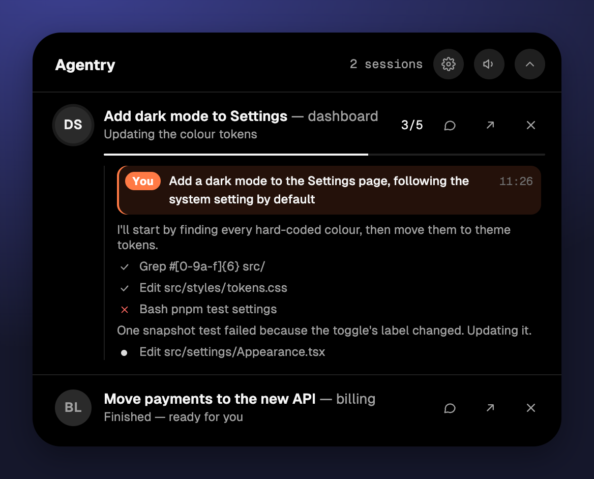
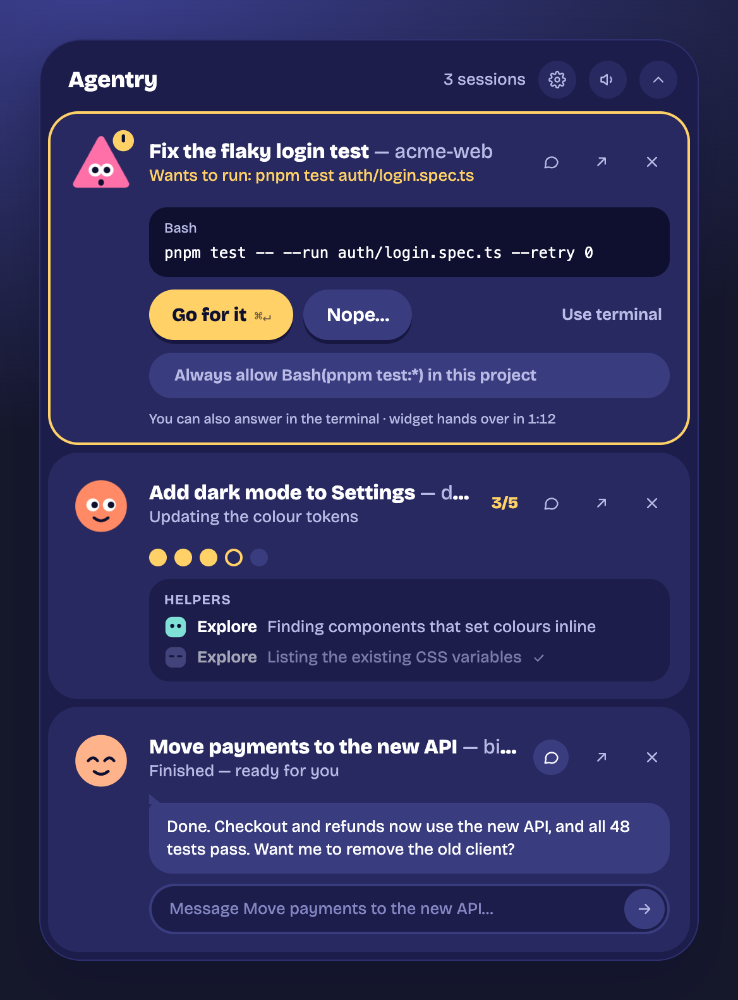
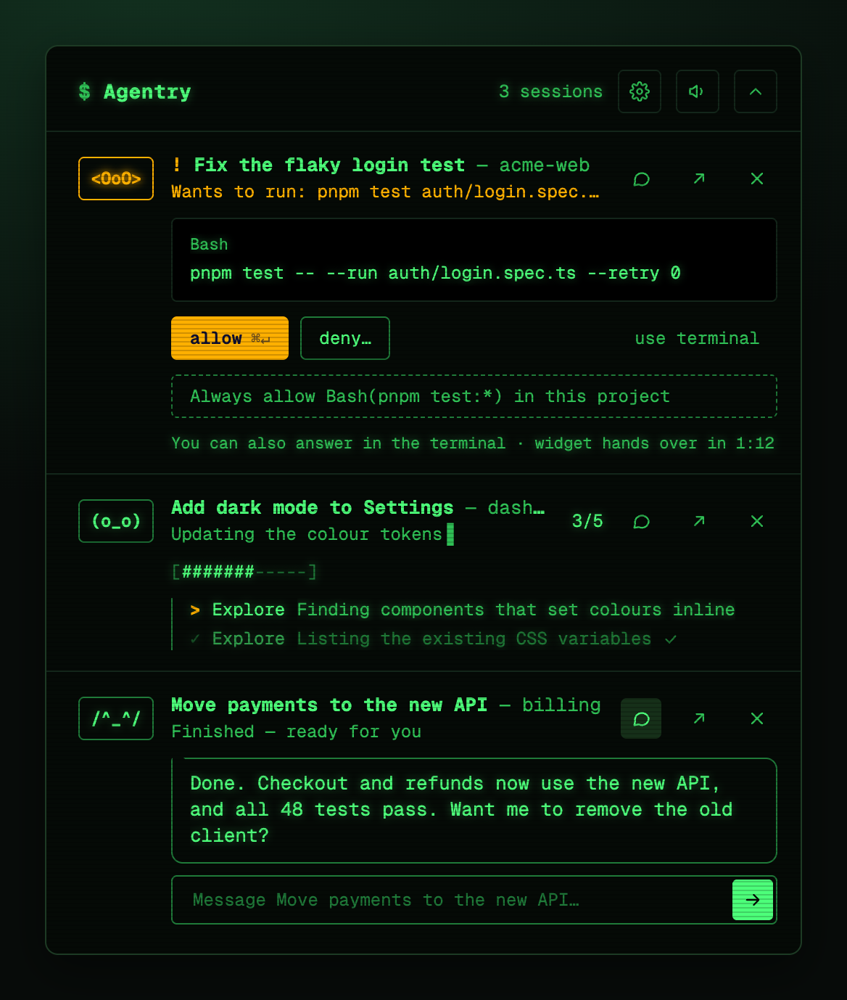
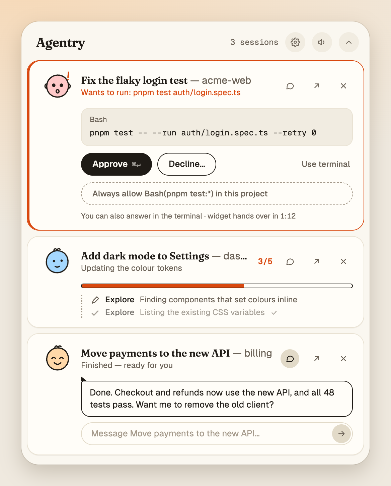
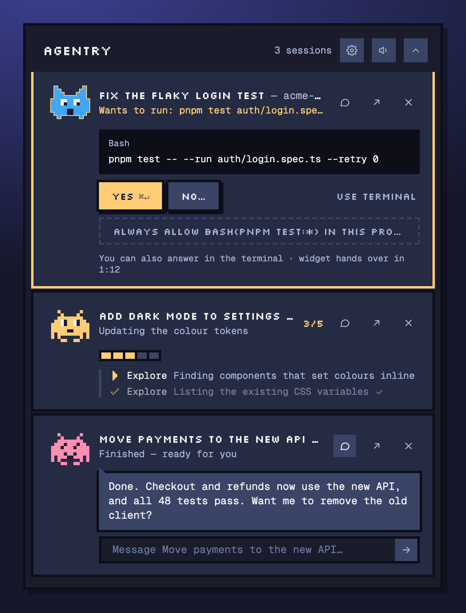
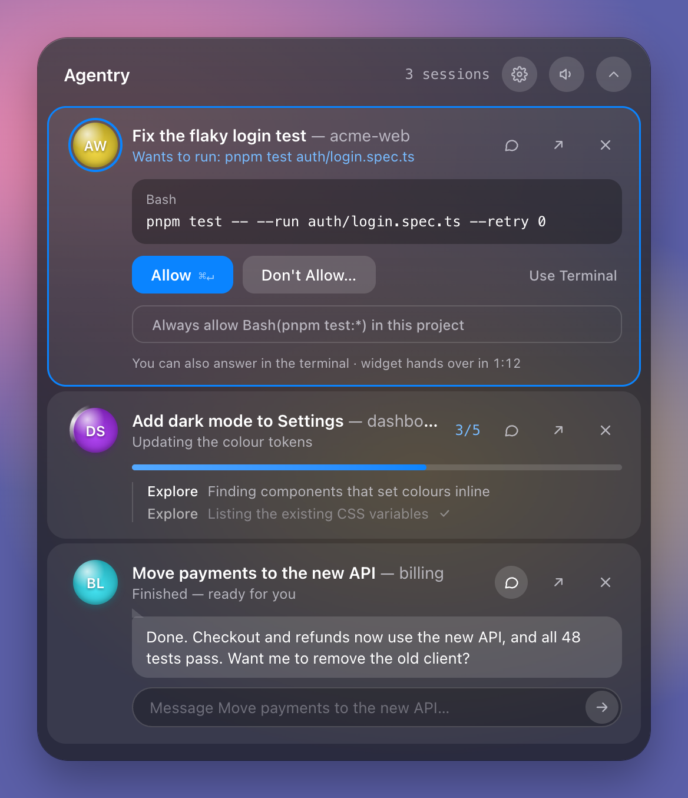
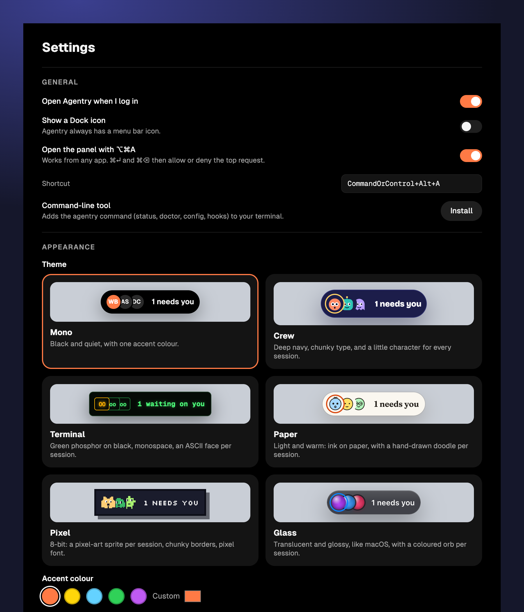

# Agentry

**Every Claude Code session, one glance away.** Agentry is a small
always-on-top widget for macOS that shows what each of your Claude Code
sessions is doing. You can approve its requests, answer its questions and
message it without hunting for the right terminal tab.

**[Try it on the website](https://loopstech.github.io/agentry/)**: the widget
there is the real one, running in your browser.

<p align="center">
  
</p>

- **See everything at once.** Every session is live in one panel: what it's
  doing, its progress through a task list, its helper agents, and whether
  it's waiting on you.
- **Approve from anywhere.** Permission requests appear with the full command
  or diff. Click **Allow**, or press **⌘↵**. The terminal can still answer.
- **Answer questions.** When Claude asks you to choose, pick an option in the
  widget.
- **Talk to Claude.** Read its latest reply and send the next message, for
  sessions in tmux, iTerm2 or WezTerm.
- **Jump back.** ↗ brings the session's terminal tab, tmux pane or editor
  window forward.
- **Stays out of the way.** If Agentry isn't running, Claude Code behaves
  exactly as if it were never installed.

## Install

**Install script.** It downloads the latest release, checks its checksum and
signature, installs the app and the `agentry` command, and asks before
connecting to Claude Code:

```sh
curl -fsSL https://raw.githubusercontent.com/loopstech/agentry/main/scripts/install.sh | sh
```

**Homebrew:**

```sh
brew install --cask loopstech/tap/agentry
```

**Download:** get `Agentry.dmg` from
[Releases](https://github.com/loopstech/agentry/releases) and drag Agentry to
Applications.

Agentry needs macOS 12 or later. On first launch a welcome screen offers to
**Connect to Claude Code**: it adds Agentry's hooks to
`~/.claude/settings.json`, backing the file up first. The welcome screen also
offers to install the `agentry` command and pick a look.

## Using Agentry

### The pill

A small pill sits under the menu bar, or around the notch on MacBooks that
have one. It shows who needs you at a glance:

<p align="center">
  
</p>

- **Open the panel:** click the pill, press **⌥⌘A** from any app, or use the
  menu bar icon. Click the panel's header to close it.
- **Move it:** drag the pill. It reopens where you left it.

### Approvals

When Claude wants to run a command or change a file, the panel opens with
the request. Claude Code asks in the terminal at the same time, and whichever
you answer first wins.

- **Allow** (⌘↵) or **Deny…** (⌘⌫). You can add a note when you deny, and
  Claude reads it.
- **Always allow** applies the rule Claude Code suggested, e.g.
  `Bash(pnpm test:*)` for this project.
- **Use terminal** hands the request back and jumps to the session.
- If you don't answer, the request goes back to the terminal after 90 seconds
  (you can change this).

The card always shows the **whole** request. Long commands scroll,
invisible or text-direction characters are revealed, and anything too long to
show can't be allowed from the widget. See [SECURITY.md](SECURITY.md).

### Questions

When Claude asks you to choose between options, answer right in the panel:

<p align="center">
  
</p>

### Recent steps

Click a session's title to see its recent steps: your prompts, Claude's
replies, and each tool call, ticked when it's done or crossed when it fails.
They keep updating while Claude works.

<p align="center">
  
</p>

### Chat

The speech-bubble button on a row shows Claude's latest reply and adds a box
for sending the next message. Agentry types it into the session's terminal for
you. This works for sessions in **tmux**, **iTerm2** and **WezTerm**, and only
while Claude is the program in the foreground there.

### Jumping to a session

↗ brings the session forward:

| Where Claude runs | What comes forward |
|---|---|
| iTerm2, Terminal.app, tmux, kitty, WezTerm | The exact tab or pane |
| VS Code, Cursor, Windsurf, VSCodium | The project's window |
| Ghostty, Warp, others | The app |

The first time, macOS asks whether Agentry may control your terminal app.
Allow it.

### Quiet mode

The speaker button in the panel header sends every request straight to the
terminal, and silences sounds, until you turn it off.

## Themes

Six looks, each with its own avatars, wording and sounds. Pick one in
**Settings → Appearance**, along with an accent colour.

<table>
  <tr>
    <td align="center"><br><b>Mono</b>: black and quiet</td>
    <td align="center"><br><b>Crew</b>: a character per session</td>
    <td align="center"><br><b>Terminal</b>: green phosphor</td>
  </tr>
  <tr>
    <td align="center"><br><b>Paper</b>: light, hand-drawn</td>
    <td align="center"><br><b>Pixel</b>: 8-bit sprites</td>
    <td align="center"><br><b>Glass</b>: translucent orbs</td>
  </tr>
</table>

## Settings

Open Settings from the gear in the panel or the menu bar icon. Every change
applies straight away.

<p align="center">
  
</p>

| Setting | Options |
|---|---|
| **Who answers permission prompts** | Agentry first (default) · only while the panel is open · terminal only |
| **Hand prompts back after** | 90 s by default |
| **Prompts shown in Agentry** | All tools, or only the ones you pick |
| **Appearance** | Theme, accent colour, attach to the notch, open on hover |
| **Sounds** | On or off, and volume |
| **General** | Open at login, Dock icon, shortcut (⌥⌘A), automatic updates |

The same settings are available from the terminal:

```sh
agentry config                                   # list everything
agentry config set approvals.timeout 120
agentry config set approvals.mode widget_when_visible
agentry config set appearance.theme crew
```

## The `agentry` command

```
agentry hooks install [--project [DIR]] [--hook-path PATH]
agentry hooks uninstall [--project [DIR]]
agentry status      # lists live sessions
agentry config [get KEY | set KEY VALUE]
agentry doctor      # checks the setup
agentry version
```

- **Scope.** `--project` uses `<DIR>/.claude/settings.local.json` instead of
  your user settings. Don't install in both places, or every event is sent
  twice; `doctor` warns you if you have.
- **Backups.** Install and uninstall back up the settings file first, as
  `settings.json.agentry-backup-<ms>`, and keep the last 5.
- **What gets touched.** Only entries whose command runs `agentry-hook` are
  added or removed. Everything else in the file is kept, in its original order.
- **Turning it off for one session.** Set `AGENTRY_DISABLE=1` in that
  session's environment.

## Uninstall

- **Homebrew:** `brew uninstall --cask agentry` removes the hooks too. Add
  `--zap` to also remove settings.
- **Otherwise:**

  ```sh
  agentry hooks uninstall     # removes only Agentry's hooks; your settings are backed up first
  rm -rf /Applications/Agentry.app ~/.agentry
  rm -f "$(command -v agentry)"
  ```

  Turn off "Open Agentry when I log in" in Settings before deleting the app,
  or remove `~/Library/LaunchAgents/Agentry.plist` afterwards.

## How it works

```
Claude Code ──runs──▶ agentry-hook ──HTTP on 127.0.0.1 + token──▶ Agentry app
     ▲                     │                                        │
     └── decision (JSON) ◀─┘◀────────── your answer ◀── widget ◀────┘
```

Claude Code runs `agentry-hook` for each hook event. The hook forwards the
event to the Agentry app over `127.0.0.1`, with a token stored in
`~/.agentry/token`. For a permission request or question, the hook waits for
your answer and hands it back to Claude Code. If the app isn't running, the
hook exits immediately and silently.

| Piece | What it is |
|---|---|
| `agentry-hook` | A tiny Rust program (~0.5 MB). Claude Code runs it for each event. |
| `agentry` | The command-line tool: hooks, `status`, `config`, `doctor`. |
| Agentry app | A Tauri app. Runs the local server and the widget. |
| `agentry-devserver` | The app's server without a window, for development. |

## Privacy and security

- The server only listens on `127.0.0.1` and requires the token.
- Tool inputs and outputs are kept in memory only, never logged or written to
  disk.
- There is no telemetry.

[SECURITY.md](SECURITY.md) explains the full security model and how to report
a vulnerability.

## Building from source

You need the Xcode Command Line Tools, Rust (via [rustup](https://rustup.rs)),
Node 20+ and pnpm (`npm i -g pnpm`).

```sh
git clone https://github.com/loopstech/agentry && cd agentry

# 1. Build the hook and the CLI
cargo build --release -p agentry-hook -p agentry-cli

# 2. Start the app (the first build takes a few minutes)
cd app && pnpm install && pnpm tauri dev
```

In a second terminal:

```sh
./target/release/agentry hooks install   # backs up ~/.claude/settings.json first
./target/release/agentry doctor          # everything should be ✓
```

### Development

```sh
cargo test --workspace                               # unit and end-to-end tests (needs app/dist: run `pnpm build` in app/ first)
cargo run -p agentry-server --bin agentry-devserver  # headless server; RUST_LOG=debug also logs payload field names
cd app && pnpm tauri dev                             # the app
scripts/tests/install-test.sh                        # the install script, against stand-in tools
cd app && pnpm site                                  # the website (app/site), with the live widget
```

- **Separate test locations.** Set `AGENTRY_HOME` and `CLAUDE_CONFIG_DIR` to
  test without touching your real `~/.agentry` and `~/.claude`.
- **Manual checks.** [docs/TESTING.md](docs/TESTING.md) lists what to try on a
  real Mac, area by area.
- **Linux builds.** Building the app on Linux needs the WebKitGTK development
  packages (see `.github/workflows/ci.yml`).
- **Releasing.** See [RELEASING.md](RELEASING.md).
- **Website.** `app/site` is published to GitHub Pages by
  `.github/workflows/pages.yml` whenever it, the UI or the screenshots change
  on `main`. Its hero runs the real widget with made-up sessions.

### Screenshots

The images in `docs/images` are generated from the real UI with made-up
sessions, so they never show anything from your machine. With `pnpm dev`
running, open
[localhost:1420/demo.html?theme=crew&scene=panel](http://localhost:1420/demo.html?theme=crew&scene=panel)
to see the demo page (scenes: `panel`, `pill`, `question`, `transcript`,
`warning`, `empty`; add `view=settings` for Settings). To regenerate the
screenshots after changing the UI (needs Google Chrome):

```sh
node scripts/screenshots.mjs          # all of them
node scripts/screenshots.mjs theme-   # just the theme shots
```

## License

[MIT](LICENSE)
